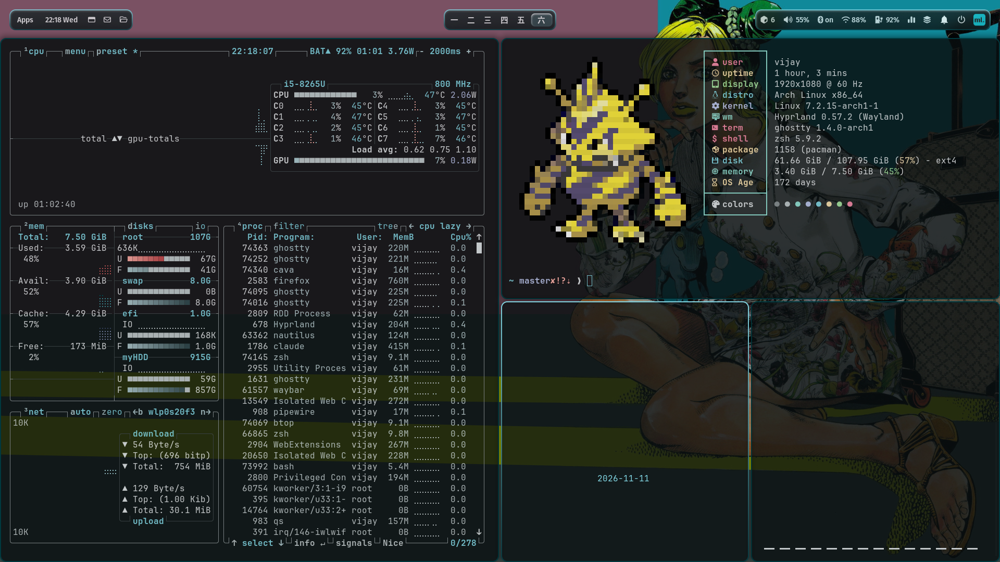
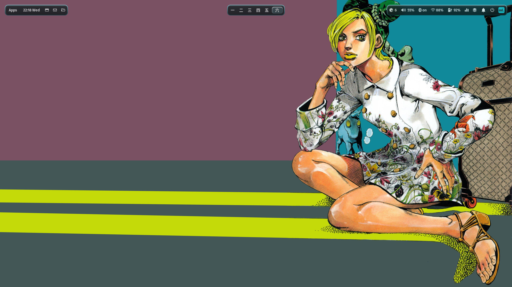
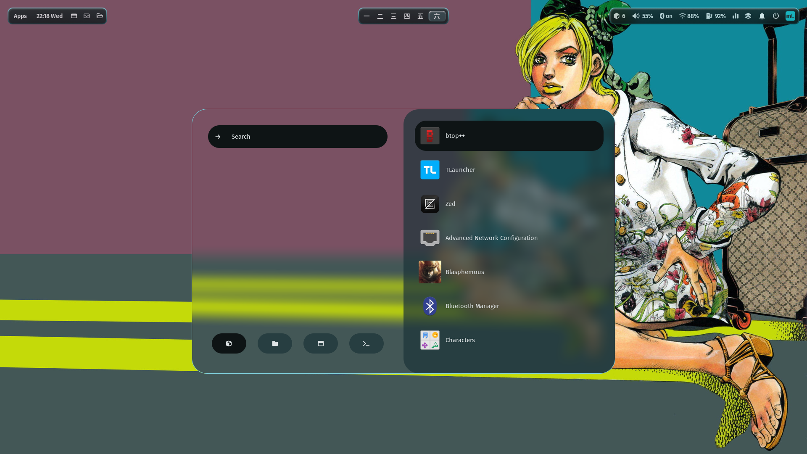
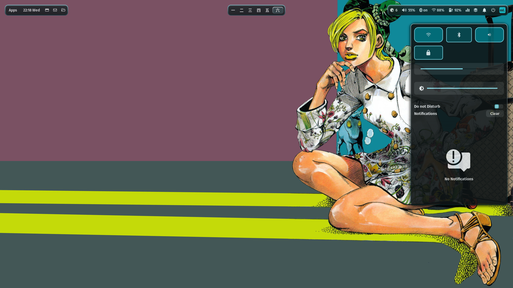

# 🏔️ Vijay's Arch Linux Dotfiles

> Personal dotfiles for my Arch Linux (Hyprland) setup on a Lenovo IdeaPad S540.


## 🖼️ Showcase

| | |
|---|---|
|  |  |
|  |  |

Regenerate with `./scripts/showcase.sh` (opens a layout on an empty workspace, captures, cleans up).

## ✨ Highlights

- **One wallpaper drives everything** — matugen recolours Hyprland, Waybar, Rofi, SwayNC, GTK, Ghostty, Starship, btop, Spotify (spicetify), Firefox (pywalfox + start page), the lock screen and the SDDM login screen.
- **Bar** — floating pills, kanji workspaces (一 二 三 四 五), now-playing, native PipeWire volume, blinking ● REC while recording.
- **Feel** — 250 ms animations, 2-pass blur, dimmed inactive windows, per-app opacity; tuned for integrated graphics.
- **Tools** — satty screenshot editor, wf-recorder, swayosd popups, screen shaders (`SUPER+ALT+V`), rmpc music player (`SUPER+ALT+M`), Quickshell overview / sidebar / wallpaper grid.
- **Reproducible** — `./install.sh all` on a fresh Arch install; `./backup.sh` to sync changes back.

## 📋 System Overview

| Component | Details |
|---|---|
| **OS** | Arch Linux (Rolling) |
| **Kernel** | Linux 7.2.x |
| **WM** | Hyprland (Wayland) |
| **Shell** | Zsh + Zinit + Starship |
| **Terminal** | Ghostty (primary), Kitty (secondary) |
| **Editor** | Neovim (lazy.nvim + Rose Pine), Zed (vim + Catppuccin), VS Code |
| **Bar** | Waybar |
| **Launcher** | Rofi |
| **Notifications** | SwayNC |
| **File Manager** | Nautilus + Yazi (TUI) |
| **Multiplexer** | Tmux (ThePrimeagen-style) |
| **Display Manager** | SDDM (follows the current wallpaper + colours) |
| **Boot Splash** | Plymouth (jojo-bizarre theme) |
| **Bootloader** | GRUB (jojo-bizarre graphical theme) |
| **GTK Theme** | adw-gtk3-dark |
| **Icons** | Papirus-Dark (folders recoloured to match the wallpaper) |
| **Cursor** | Bibata Modern Classic |
| **Input Method** | Fcitx5 (fcitx5-bamboo) |
| **Fonts** | JetBrainsMono Nerd Font, FiraCode Nerd Font, Fira Sans, Source Han Sans JP |
| **AUR Helper** | yay |
| **Containers** | Docker + Docker Compose |
| **Databases** | PostgreSQL, MongoDB, Valkey |
| **Languages** | Node.js, Bun, Rust, Python, Go, Lua, Java, Ruby, C/C++ |
| **Hardware** | Lenovo IdeaPad S540-15IWL (Intel + NVIDIA) |

## 🗂️ What's Included

```
dotfiles/
├── zsh/                  # Zsh config (Zinit, aliases, keybindings)
├── tmux/                 # Tmux config (ThePrimeagen-style)
├── nvim/                 # Neovim config (lazy.nvim, LSP, Treesitter)
├── starship/             # Starship prompt config
├── ghostty/              # Ghostty terminal config
├── kitty/                # Kitty terminal config
├── fastfetch/            # Fastfetch config + launch scripts + theme images
│   └── themes/           #   └── Berserk, ChainsawMan, Dandadan, JJK, etc.
├── git/                  # Git config
├── zed/                  # Zed editor settings (vim mode, Catppuccin)
├── vscode/               # VS Code settings + extensions list
├── lazygit/              # Lazygit config (Rose Pine theme, delta diffs)
├── lazydocker/           # Lazydocker config
├── opencode/             # OpenCode AI config
├── gtk-3.0/              # GTK3 theme settings
├── gtk-4.0/              # GTK4 theme settings
├── qt6ct/                # Qt6 theme config (WhiteSur icons)
├── xsettingsd/           # X settings daemon config
├── hypr/                 # Hyprland WM config (Lua-based)
│   ├── conf/             #   └── animations, decorations, keybindings, etc.
│   ├── scripts/          #   └── power, screenshot, gamemode, etc.
│   ├── effects/          #   └── wallpaper effects
│   └── assets/           #   └── lockscreen images
├── jay/                  # Jay/ML4W framework (scripts, settings, themes)
│   ├── scripts/          #   └── wallpaper, autostart, updates, etc.
│   ├── settings/         #   └── waybar, rofi, dock preferences
│   ├── themes/           #   └── glass, modern, transparent
│   ├── wallpapers/       #   └── JoJo wallpapers + default
│   └── listeners/        #   └── GTK theme switcher, low battery
├── quickshell/           # Quickshell Wayland widgets (calendar, power, etc.)
├── matugen/              # Material color generation (auto-theming)
├── rofi/                 # Rofi launcher config
├── waybar/               # Waybar status bar + themes
├── swaync/               # SwayNC notification config + themes
├── wlogout/              # Wlogout power menu + icons + themes
├── nwg-dock-hyprland/    # NWG dock config + themes
├── nwg-displays/         # Display layout configuration
├── nwg-look/             # GTK styling configuration
├── sidepad/              # Sidepad scratchpad utility & configs
├── jay-dotfiles-settings/# Jay settings manager config
├── walker/               # Walker launcher theme
├── waypaper/             # Waypaper wallpaper manager config
├── btop/                 # Btop system monitor config
├── fcitx5/               # Fcitx5 IME input method config
├── bashrc/               # Modular bash configuration scripts
├── boot/                 # 🌟 Custom Boot Themes
│   ├── grub/             #   └── JoJo GRUB theme & installer script
│   └── plymouth/         #   └── JoJo Plymouth splash theme
├── system/               # System templates (sddm.conf, pacman.conf, grub)
├── wallpapers/           # 🖼️ Desktop wallpapers collection
├── scripts/              # Custom scripts (tmux-sessionizer, dev-tools, jay)
├── chromium-flags.conf   # Chromium Wayland flags
├── edge-flags.conf       # Edge Wayland flags
├── .bash_profile         # Bash profile (PATH, cargo env)
├── .zshenv               # Zsh env (Mesa/WebKit GPU hardware flags)
├── .profile              # User profile
├── .npmrc                # npm config
├── mimeapps.list         # Default application associations
├── user-dirs.dirs        # XDG user directories
├── packages.txt          # Explicitly installed pacman packages (172)
├── packages-aur.txt      # AUR packages list (17)
├── install.sh            # 🚀 Installer (menu / per-group)
├── backup.sh             # 🔄 Sync live system → repo
├── manifest.txt          # 🗺️  repo path → $HOME path mapping
└── README.md             # This file
```

## 🆕 Fresh Arch PC

**Before running the script** you need a booted Arch install (e.g. via `archinstall`) with:
- your user account, in the `wheel` group with sudo enabled
- internet (`nmtui` or `iwctl`)
- GRUB as bootloader if you want the JoJo boot themes (skipped automatically otherwise)

```bash
sudo pacman -S --needed git
git clone https://github.com/<you>/dotfiles ~/Projects/dotfiles
cd ~/Projects/dotfiles
./install.sh all        # ~30–60 min: packages → configs → services → dev tools → boot theme
reboot
```

What `all` handles for you: enables the `multilib` repo, installs `yay`, skips NVIDIA/Intel GPU packages the PC doesn't have,
initialises PostgreSQL, adds you to the `docker` group, offers zsh as default shell, keeps sudo alive during long builds.

**After first login:** press `SUPER+SHIFT+W` once to pick a wallpaper (generates colours + lockscreen images),
open Spotify once and log in, then run `~/.config/hypr/scripts/spicetify-setup.sh`.
For a login screen that follows your wallpaper (instead of the stock astronaut), run `~/.config/hypr/scripts/sddm-setup.sh` once.

## 🚀 Quick Install

```bash
git clone <this-repo> ~/Projects/dotfiles
cd ~/Projects/dotfiles
./install.sh            # interactive menu — pick what you want by number
```

Install only what you need — each group installs its packages, symlinks its configs, and runs its setup:

```bash
./install.sh shell            # zsh + bash + starship (+ zinit, offers chsh to zsh)
./install.sh shell tmux editors   # mix and match
./install.sh --list           # show every group and exactly which files it links
./install.sh --dry-run shell  # preview, change nothing
./install.sh --no-pkgs shell  # only link configs
./install.sh all              # full machine restore
```

| Group | What it sets up |
|---|---|
| `shell` | `.zshrc`, `.zshenv`, `.profile`, `.bash_profile`, `.bashrc` (loads `~/.config/bashrc/*`), Starship |
| `terminal` | Ghostty, Kitty, Fastfetch (+ anime themes), Btop |
| `tmux` | `.tmux.conf`, TPM + plugins, `tmux-sessionizer` |
| `editors` | Neovim, Zed, VS Code settings, `.gdbinit` |
| `dev` | `.gitconfig`, `.npmrc`, Lazygit, Lazydocker, OpenCode |
| `hyprland` | Hyprland, Waybar, Rofi, Walker, SwayNC, Wlogout, Quickshell, Matugen, nwg-dock, Jay/ML4W, wallpapers |
| `theme` | GTK 3/4, Qt6ct, nwg-look, xsettingsd |
| `misc` | Fcitx5, mimeapps, XDG user dirs, pavucontrol, Chromium/Edge Wayland flags |
| `packages` | everything in `packages.txt` + `packages-aur.txt` |
| `services` | systemd services + SDDM config |
| `dev-tools` | npm globals, Rust, Bun, VS Code extensions |
| `boot` | JoJo GRUB + Plymouth themes |

Existing files are moved to `~/.dotfiles-backup/<timestamp>/` before linking. All file mappings live in **`manifest.txt`**.

## 🔄 Updating the backup

```bash
./backup.sh             # copy live configs → repo, refresh package lists, VS Code extensions, /etc files
./backup.sh shell       # only one group
git add -A && git commit -m "sync dotfiles"
```

## 🔑 Key Keybindings

### Neovim
| Key | Action |
|---|---|
| `Space` | Leader key |
| `<leader>pf` | Find files (Telescope) |
| `<C-p>` | Git files |
| `<leader>ps` | Grep search |
| `<leader>a` | Harpoon add |
| `<C-e>` | Harpoon menu |
| `<leader>gg` | LazyGit |
| `<leader>f` | Format file |
| `-` | Oil file manager |

### Tmux
| Key | Action |
|---|---|
| `C-a` | Prefix (instead of C-b) |
| `prefix + \|` | Split horizontal |
| `prefix + -` | Split vertical |
| `prefix + h/j/k/l` | Navigate panes |
| `prefix + g` | LazyGit |
| `prefix + d` | LazyDocker |
| `prefix + b` | Btop |
| `prefix + f` | Tmux sessionizer |

### Zsh
| Key | Action |
|---|---|
| `Ctrl+R` | Fuzzy history search (fzf) |
| `Ctrl+V` | Paste from clipboard |
| `↑/↓` | History substring search |
| `z <dir>` | Zoxide smart cd |

## 📦 Notable CLI Tools

- **eza** — Modern `ls` replacement
- **bat** — `cat` with syntax highlighting
- **fzf** — Fuzzy finder
- **zoxide** — Smart `cd`
- **lazygit** / **lazydocker** — TUI for git/docker
- **btop** — System monitor
- **yazi** — Terminal file manager
- **starship** — Cross-shell prompt
- **fastfetch** — System info (with anime/pokemon themes!)
- **gum** — Interactive shell scripts
- **fd** — Fast `find` alternative
- **ast-grep** — Structural code search

## 🛠️ Development Environment

### Editors
| Editor | Config | Notes |
|---|---|---|
| **Neovim** | `nvim/` | Primary editor — lazy.nvim, Rose Pine, Mason LSP |
| **Zed** | `zed/` | Vim mode, Catppuccin Macchiato, Copilot AI |
| **VS Code** | `vscode/` | Minimal — used for container dev |

### Languages & Runtimes
| Tool | Install Method |
|---|---|
| **Node.js** + **npm** | pacman |
| **Bun** | curl installer |
| **Rust** (rustup, cargo) | pacman + rustup |
| **Python** + pip + virtualenv | pacman |
| **Go** | pacman |
| **Lua** + LuaRocks | pacman |
| **Java** (JRE 21) | pacman |
| **Ruby** | pacman |
| **Clang** / **GCC** | pacman |
| **ARM GCC** (embedded) | pacman |

### npm Globals
- `typescript`, `typescript-language-server`, `eslint`, `prettier`

### Neovim LSP Servers (via Mason)
- `lua_ls`, `pyright`, `ts_ls`, `clangd`, `rust_analyzer`, `gopls`, `jdtls`

### Docker & Databases
- **Docker** + **Docker Compose** (systemd enabled)
- **PostgreSQL** (systemd enabled)
- **MongoDB** (AUR) + **mongosh**
- **Valkey** (Redis-compatible)

## 📝 Notes

- The Hyprland config uses **Lua** (ML4W/Jay framework style)
- Neovim uses ThePrimeagen-style keymaps
- Tmux status bar uses Rose Pine colors
- Lazygit uses Rose Pine theme + delta for diffs
- Fastfetch randomly shows Pokemon pixel art or anime theme images
- GTK uses macOS cursor theme with WhiteSur icons
- Chromium/Edge flags enable native Wayland support
- Qt6 apps themed via qt6ct with WhiteSur icons
- Zed editor runs in vim mode with Catppuccin Macchiato theme

## 📄 License

Feel free to use, modify, and share. No license required.
